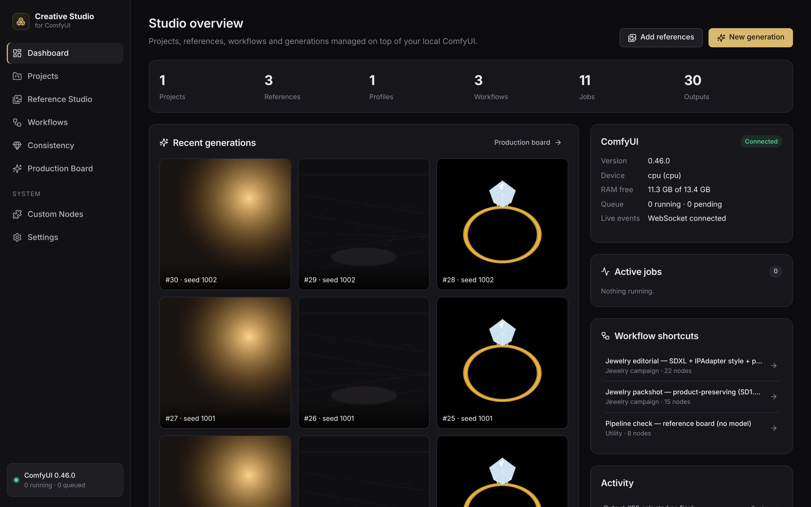

# ComfyUI Creative Studio

**A local-first production layer for ComfyUI.** Organise visual references, product and character profiles, workflows and generation jobs — then run, track, compare and reproduce them on your own ComfyUI.



> Screenshots are real captures of this app running against **ComfyUI 0.46.0 on CPU in a Linux test container**. The images are synthetic placeholders drawn by the demo seeder and outputs of the model-free "pipeline check" workflow — no diffusion model was available there. See [Verification status](#verification-status).

## What it does

| Module | What you get |
|---|---|
| **Projects** | Projects → campaigns, templates (jewelry, fashion, e-commerce), activity history, archive/restore, final selects. |
| **Reference Studio** | Upload & tag images in 12 categories, palettes and perceptual hashes, search/filter, collections, reuse across projects. |
| **Profiles** | Product and Character profiles: role-tagged reference images (primary/detail/face…), attributes, *details to preserve*, deterministic prompt fragments. |
| **Workflow Manager** | Import UI or API-format JSON (originals preserved), best-effort UI→API conversion via `/object_info`, dependency check (missing nodes, missing models, graph/type errors), auto-discovered editable parameters. |
| **Consistency Manager** | Reusable bindings of profile + reference images + conditioning strengths onto a workflow (IPAdapter, ControlNet, inpainting, img2img, profile-loader nodes). Heuristic output-vs-reference comparison. |
| **Production Board** | Batches with seed strategies, live progress via WebSocket, history-verified completion, gallery, 2–4-way comparison with parameter diff, favorites/finals/ratings, ZIP export with metadata + exact API prompt, one-click reproduce. |
| **ComfyUI integration** | `/system_stats`, `/object_info`, `/upload/image`, `/prompt`, `/ws`, `/queue`, `/history`, `/interrupt`, `/view`, `/view_metadata`. Never reports a job complete unless ComfyUI's history does. |
| **Custom nodes** | 7 installable nodes: Reference Collector, Product/Character Profile Loader, Prompt Template, Generation Metadata Saver (PNG + sidecar JSON + model SHA-256), Batch Variant Manager, Project Metadata. |

## Quick start (macOS / Linux)

Requirements: Python 3.10+, Node.js 18+, a local ComfyUI.

```bash
./scripts/setup.sh
```

```bash
./scripts/install_nodes.sh /path/to/ComfyUI
```

Restart ComfyUI (`python main.py` — it listens on `http://127.0.0.1:8188`), then:

```bash
./scripts/start.sh
```

Open <http://127.0.0.1:8420>, click **Create demo project** on the dashboard, open **Consistency → Aurora · pipeline check** and press **Generate**. That workflow needs no model, so it verifies the full app ↔ ComfyUI ↔ custom-node loop on any machine. For real jewelry imagery, install a model as described in [MODEL_COMPATIBILITY.md](docs/MODEL_COMPATIBILITY.md).

## Documentation

- [User guide](docs/USER_GUIDE.md) — the jewelry campaign walkthrough, step by step
- [Architecture](docs/ARCHITECTURE.md) — components, data model, truth model for job state
- [API](docs/API.md) — REST endpoints
- [Custom nodes](docs/CUSTOM_NODES.md) — node reference and installation
- [Model compatibility](docs/MODEL_COMPATIBILITY.md) — Mac hardware sizing, models, licenses, limits of reference preservation
- [Development](docs/DEVELOPMENT.md) — setup, tests, conventions, troubleshooting
- [Roadmap](docs/ROADMAP.md)

## Repository layout

```
backend/                FastAPI + SQLAlchemy (SQLite) API, ComfyUI client, job tracker
frontend/               React + TypeScript + Vite UI
custom_nodes/comfyui-creative-studio-nodes/   independent ComfyUI node package
examples/workflows/     API-format workflows for the jewelry demo
scripts/                setup, start, dev, install_nodes
docs/                   documentation and screenshots
```

## Verification status

Be precise about what has been tested where:

| Item | Status |
|---|---|
| Backend API (projects, references, profiles, workflows, consistency, jobs, outputs, export, compare) | Implemented · unit/API-tested (25 tests) |
| Job state machine (queued, running, completed, failed, interrupted, cancelled, lost, ComfyUI unreachable) | Integration-tested with a mocked ComfyUI |
| Full loop: upload → `/prompt` → WebSocket + `/history` → `/view` → metadata | **Tested against a real ComfyUI 0.46.0** (CPU, Linux) with the model-free pipeline-check workflow, via API test and a browser-driven run |
| Custom nodes | 16 tests (torch); all 7 nodes load and execute in real ComfyUI 0.46.0 |
| UI→API conversion | Tested on ComfyUI's default workflow against real `/object_info` (only missing-model errors remained, as expected) |
| Example jewelry workflows (SD1.5 inpainting, SDXL + IPAdapter) | Node classes, inputs and link types **validated against real `/object_info`** (incl. ComfyUI_IPAdapter_plus); **not executed** — no checkpoints were available |
| Frontend | 10 Vitest/RTL tests; type-checked; browser-tested with Playwright |
| macOS / Apple Silicon (MPS) and image quality of the jewelry workflows | **Not yet verified** — needs a run on your Mac (steps in the user guide) |

## License

Code: MIT. Models you download keep their own licenses — see [MODEL_COMPATIBILITY.md](docs/MODEL_COMPATIBILITY.md).
